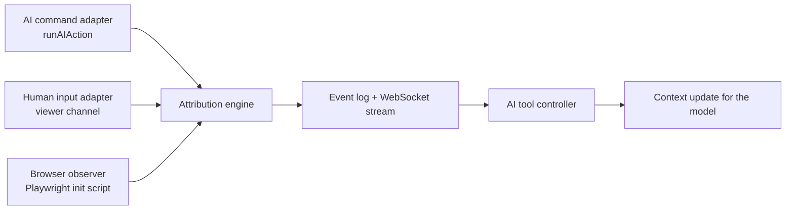

# ActionTrace

**Know which browser actions came from the user, which came from the AI, and when the evidence is uncertain.**

ActionTrace is a TypeScript SDK, an event protocol, and a Playwright adapter that tell an AI tool's controller *who* did something in a shared browser session, *how sure* we are, and *what changed since its last observation*.

> Status: working MVP. Everything below marked **tested** runs in `npm test` against real Chrome; things marked **not built** are deliberately out of the MVP.



## Demo

<video src="https://github.com/nvaishnavisriyaa/ActionTrace/raw/main/docs/media/demo.mp4" controls width="720">
  Can't play the video inline? <a href="https://github.com/nvaishnavisriyaa/ActionTrace/raw/main/docs/media/demo.mp4">Download it directly</a>.
</video>

## Try it

Requires Node 22+ and an installed Chrome or Edge (no browser download).

```bash
npm install
npm test          # attribution rules, replay, security, integration surfaces, and real-browser end-to-end suites
npm run bench     # precision + coverage + latency against real Chrome with known ground truth
npm run demo      # shared browser: you are the human, a scripted agent is the AI
npm run serve -- --demo --cdp-port 9222   # sidecar for external AI tools (see docs/DEMO.md)
```

`npm run demo` prints a link. Open it, press **Start AI agent**, and while it fills the form click a different plan in the viewer. The AI controller panel shows the model being told about your change, and the agent declines to overwrite it. Set `HEADED=1` to also show a real browser window; coverage then drops to *limited*, because the viewer can no longer be the only human path, and the UI says so.

## The core idea

The critical design rule: **recording an AI command proves the AI issued it. It does not prove that every browser event during it was caused by it. And an event that matches no AI command is not automatically human.**

Every record has two independent fields:

| Field | Values |
|---|---|
| `actor` | `human` · `ai` · `page` · `unknown` |
| `certainty` | `confirmed` · `inferred` · `unknown` |

How an input event (click, edit, scroll) is attributed, in `src/attribution.ts`:

1. The **browser observer** reports the event. It sends no actor, and cannot assign one.
2. The engine finds **candidate sources**: human-channel inputs registered *before* dispatch, and AI commands registered *before* dispatch. A candidate must be compatible in kind, tab, time window, and not contradicted by target or pointer position.
3. Each candidate is **verified** (pointer position, element role and label, scroll direction, or URL matches the event itself) or **weak** (kind and timing only). Many keystrokes from one channel are one source, not many.
4. Decision:

| Situation | Result |
|---|---|
| One source, verified | that actor, `confirmed` |
| One source, weak | that actor, `inferred` |
| Human and AI both plausible, one verified | the verified one, `inferred` (competition caps certainty) |
| Human and AI both plausible, no clear winner | `unknown`, with both candidates listed as evidence |
| Script-dispatched event (`isTrusted: false`) | `page`, `inferred` |
| No source explains a trusted input | `unknown`, and human-input coverage is downgraded to `limited` |

Page changes (navigation, DOM mutation, new tab) are **separate records** from the input that may have caused them. They carry `causedBy` plus a `causal_link` evidence item, and actor `page`. A click and the navigation it triggers never share an owner by accident. If a weak AI attribution belongs to a command that later fails or is cancelled, an `attribution_update` record downgrades it to `unknown`.

## Integrating

Three steps (runnable: [`examples/integrate.ts`](examples/integrate.ts)):

```ts
import { ActionTrace, PlaywrightAdapter, PlaywrightAgentActions, ViewerAdapter } from "actiontrace";

// 1 + 2. Attach the observer; route the supported human channel through an adapter.
const pw = new PlaywrightAdapter(context);
const trace = await ActionTrace.attach({ browserAdapter: pw, humanInputAdapter: new ViewerAdapter(pw) });

// 3. Subscribe the controller, and ask "what changed since I last looked?" at each model step.
trace.subscribe(event => controller.enqueue(event));
const feed = trace.contextFeed();
const update = feed.next();          // update.summary goes into the model's next prompt
                                     // update.humanTouched is the structured form

// AI commands are recorded before dispatch, with their lifecycle.
await trace.runAIAction(
  { agentId: "agent-1", action: "click", tabId: pw.tabId(page),
    resolveTarget: () => pw.describe(locator) },   // lets the engine verify the match
  () => locator.click(),
);
```

`PlaywrightAgentActions` wraps `click / fill / check / press / goto` this way. Your model and planner are untouched. An AI tool that already issues Playwright calls from one place needs only that one call site changed.

**Using Codex, Antigravity, Claude Code, Cursor or any other MCP client?** Run the sidecar (`actiontrace serve --cdp-port 9222 --info-file actiontrace-session.json`) and add one MCP server entry (`actiontrace-mcp`, see [`examples/mcp-config.json`](examples/mcp-config.json)). The model then browses with `browser_*` tools whose actions are recorded as AI actions, and is told what the user changed.

**Not in TypeScript, or can't share a process?** Run the sidecar (`actiontrace serve`) and use the HTTP API, the `AgentClient` / `TraceClient` classes, the `actiontrace agent` shell commands, or the MCP server above. See **[docs/INTEGRATION.md](docs/INTEGRATION.md)** for which path fits which tool, the full HTTP reference, how to write an adapter for another automation framework, and exactly which paths have been tested. **[docs/DEMO.md](docs/DEMO.md)** is a step-by-step demo where you are the human and an AI acts through shell commands.

**What it does not do:** deliver anything to a model by itself. The controller consumes the stream continuously and injects updates at the model's next supported execution boundary. Interrupting a running model or command is a separate host capability. Compatibility with a particular product depends on that product's browser controller exposing a place to hook in; none is assumed.

### Network API

`TraceServer` (`src/server.ts`) exposes the stream and the developer APIs on loopback:

| | |
|---|---|
| `WS /ws/stream` | First message `{type:"auth", sessionId, token, since?}`. Replays retained events after `since`, then streams live. Gaps arrive as a `stream_gap` record. |
| `WS /ws/viewer` | Human channel: frames out, `click / scroll / key / navigate / switch_tab` in. Separate `humanToken`. |
| `GET /api/sessions/:id/events?since=` | Bounded replay (Bearer token) |
| `GET /api/sessions/:id/context?since=` | The concise "what changed" update |
| `GET /api/sessions/:id/capabilities` | Coverage and stream health |
| `POST /api/sessions/:id/observation` | `{enabled}`: start / stop observation |

### Protocol

[`schema/trace-event.schema.json`](schema/trace-event.schema.json) is the language-neutral contract (JSON Schema 2020-12). Kinds: `input`, `navigation`, `observation`, `command`, `attribution_update`, `capability_change`, `stream_gap`.

## Privacy and security

Tested unless noted.

- **No typed content, ever.** Edits record that an edit occurred, never the value, the keys, or the length. Password-type and `cc-*` / one-time-code fields are additionally flagged `sensitive`. A test feeds a password and an email into the page and asserts neither appears anywhere in the event JSON.
- **Redaction:** URLs lose credentials and fragments; sensitive query values and token-looking path segments are masked; labels lose emails and long digit runs, control and bidi characters, and are length-bounded.
- **Page text is untrusted data.** Pages can't assign an actor: observer messages are field-whitelisted and the engine ignores any `actor` / `certainty` / `evidence` in them (tested). Context lines quote labels as JSON strings.
- **Consumers:** per-session bearer tokens compared in constant time; tokens travel in the first WebSocket message or a header, never a URL query. Host and Origin checks block DNS rebinding and cross-site WebSocket hijacking. Slow consumers are closed and can resume with `since`. The demo puts the automated site on a different origin from the control UI.
- **Bounded everything:** ring buffer, input rate limit on the viewer, observer batching (edits 60 ms, scrolls 80 ms, mutations 100 ms and ≤10/s).

### Threat model, and what isn't solved

- **A hostile page can forge observations.** Playwright init scripts run in the page's main world. The observer captures its host binding in a closure and deletes the global, which stops casual access, but a page that runs before it, or patches built-ins, could still call it. A forged observation can't claim an actor. It can inject noise, or consume an unclaimed human intent. Moving the observer to a CDP isolated world is the fix; it's not done.
- **Sub-frames:** click, edit and scroll are observed in every frame; navigation and mutation are reported for the top frame only.
- **Uninstrumented paths are detected, not attributed.** Input through a path that is neither the viewer nor `runAIAction` (a person using a visible window, or an AI calling `page.click` directly) stays `unknown` and flips human-input coverage to `limited` (tested).
- **`page.evaluate`-driven AI actions** synthesise events (`isTrusted: false`), so they're labelled `page`, not `ai`. Set `claims` on the command if you want it to own them.
- **Ordering** is per-session sequence numbers, not perfect causal order across independent sources. Clocks are the host's; skew tolerance is 50 ms.
- A timing window plus a verified match is *evidence*, not proof. `confirmed` means "instrumented source, in declared coverage, event-level match". It does not mean "cannot be wrong".

## Requirements status

| | Status |
|---|---|
| FR1 commands recorded before dispatch, lifecycle (started / completed / failed / cancelled) | tested |
| FR2 human input from a configured channel, with channel id | tested (viewer) |
| FR3 click, edit, scroll, navigation, mutation, tabs; tab / frame / document ids | tested |
| FR4 evidence-based attribution with an unknown state | tested |
| FR5 input and resulting page change are separate records with an optional causal link | tested |
| FR6 streaming continues during an in-flight command | tested |
| FR7 resume from a sequence number, bounded replay, explicit gaps | tested |
| FR8 capabilities: human coverage, AI coverage, stream health | tested |
| FR9 concise context updates since last consumed event | tested |
| FR10 developer timeline (commands, observations, evidence, connection and gap markers) | built (`demo/public`), verified by hand, no automated UI test. It shows stream connection and gap markers; it does not track a per-event delivery acknowledgement. |

Acceptance scenarios 1-8 each have a named test in [`test/scenarios.test.ts`](test/scenarios.test.ts); scenarios 1, 3, 5, 7, 8 also run against a real browser in [`test/e2e.test.ts`](test/e2e.test.ts).

## Measured results

`npm run bench` drives randomized human (via the viewer) and AI (via `runAIAction`) actions in real headless Chrome, including overlapping and same-element cases, with ground truth known by construction. It reports precision and coverage together.

250 trials, seed 7, headless Chrome:

| Metric | Result | PRD target |
|---|---|---|
| Coverage (supported input actions attributed, not unknown) | 271 / 275 = **98.5%** | ≥ 95% |
| Precision of `confirmed` labels | 271 / 271 = **100%** | ≥ 99% |
| Same-element simultaneous AI + human actions wrongly confirmed | 0 / 38 (all left uncertain) | none |
| Missed observations | 0 | |
| Capture-to-controller latency | p50 2 ms, p95 89 ms (n = 341) | p95 < 100 ms |

The 4 supported actions left uncertain share one cause: after an unresolved same-element overlap, the unclaimed human intent stays a candidate for its 600 ms window, so an immediately following AI click on that element competes with it and stays `unknown`. That is conservative rather than wrong, but it is a real coverage cost. Batched events (edits, scrolls) are timed from their last underlying event, so the latency figure includes batching delay.

Read these with care. The ground truth comes from the same harness that generates the actions; it's one machine, one clock, one demo page, headless Chrome, a loopback viewer. It validates the attribution logic, not real-world accuracy, and the latency numbers are not a user-network measurement. The PRD's targets are validation goals, not claims.

## Not built

- MCP *resource subscriptions*, and an MCP proxy that registers the AI's actions made through *another* browser MCP server (ActionTrace's own `browser_*` tools are attributed; a host's built-in browser is not observable)
- Any integration into a closed AI product; Puppeteer / Selenium / Playwright MCP / browser-use adapters are untested (see docs/INTEGRATION.md)
- A second automation adapter (the "integration validation" phase) and browser-extension observation
- Hosted analytics, long-term storage, persistence across restarts
- Isolated-world observer; attribution of arbitrary page mutations; desktop-level input attribution
- Browsers other than Chromium for the viewer's screencast (observer and AI adapter use only Playwright APIs; the viewer falls back to screenshots)

## Layout

```
src/protocol.ts          event + adapter contracts
src/attribution.ts       the engine: candidates, evidence, decisions
src/event-log.ts         ordered ring buffer, replay, gaps
src/context.ts           "what changed since my last observation"
src/actiontrace.ts       the facade (attach / runAIAction / subscribe / capabilities)
src/observer-script.ts   code that runs inside the page
src/adapters/            playwright.ts (observer + AI actions), viewer.ts (human channel)
src/server.ts            WebSocket + HTTP, auth, replay, command registration
src/client.ts            TraceClient / AgentClient for other processes
src/mcp.ts, cli-mcp.ts   MCP bridge (actiontrace-mcp)
src/cli.ts, agent-cli.ts sidecar (actiontrace serve) and shell actions (actiontrace agent)
schema/  docs/           JSON Schema for the event contract; integration guide and demo
demo/  bench/  examples/ shared-browser demo, benchmark, minimal integration
test/                    scenarios, redaction, server, real-browser e2e
```

## License

[MIT](LICENSE) — use it, fork it, ship it.
